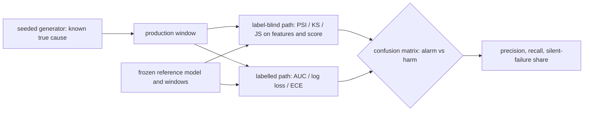
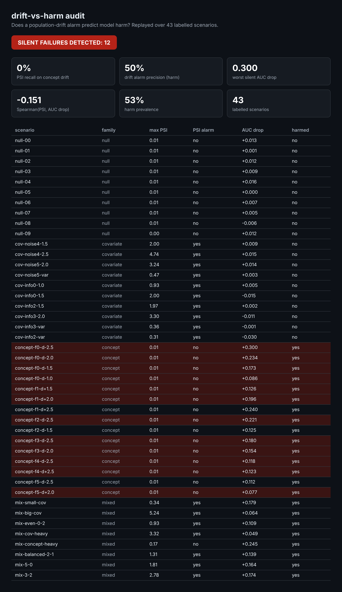
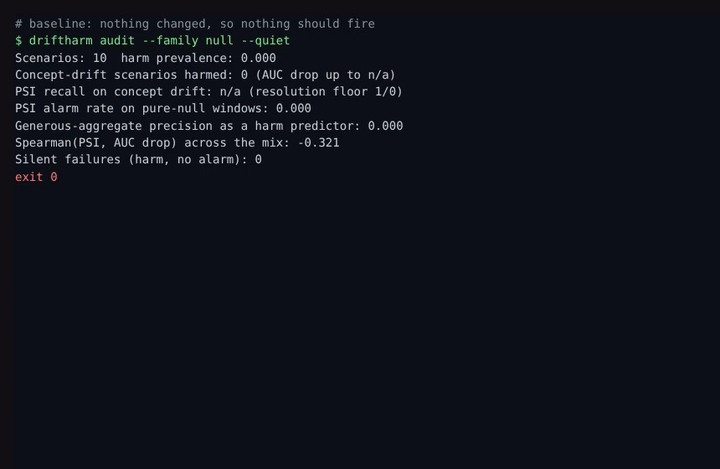

# drift-vs-harm

**A labelled replay harness that answers whether a population-drift alarm actually predicts model harm, by scoring drift detectors (PSI, KS, Jensen-Shannon) against the AUC loss a frozen model really suffered. On the scenarios where only the labelling rule moves, PSI fires on 0 of 15 degradations while AUC falls 0.30.**


## The impossibility

A drift detector is a function of the input distribution P(X), and of the model's own
score f(X). Harm, the model actually getting worse, is a function of the joint with
the label, P(Y|X). Nothing in the detector's inputs carries a label. So there is a
whole class of failure the detector is not merely bad at but structurally blind to:
**concept drift**, where the labelling rule P(Y|X) moves while the inputs P(X) stay
exactly where they were. The model's answers quietly become wrong; the inputs, and
therefore the scores, look identical to yesterday.

Four questions this answers that a drift dashboard cannot:

1. When the labelling rule changes but the inputs do not, does a drift alarm fire?
2. When a drift alarm does fire, did the model actually get worse?
3. If you rank your windows by how much they drifted, have you ranked them by harm?
4. In the window before labels arrive, what share of real harm is a drift monitor
   blind to?

## The uncomfortable numbers

Measured across 43 labelled scenarios whose true cause is known, every figure below
re-measured by CI on each run:

- On the concept-drift family, PSI has a **recall of 0%**: it fires on 0 of 15
  scenarios, each carrying a real degradation, the worst of which is an AUC fall of
  0.30. Jensen-Shannon is identical, with 0% for JS as well. This is the silent class.
- A drift alarm is a poor harm predictor: its **precision of 50%** sits at or below
  the harm prevalence of 53% of the suite, so being told it fired tells you nothing
  you did not already know.
- Drift magnitude runs the wrong way against harm: the **correlation of -0.15**
  (Spearman) across the mix is negative, because the loudest drift is harmless and the
  real harm is silent.
- Nearly 70% of realised harm (16 of 23 harmed scenarios) is invisible to PSI until
  the labels come in.

This is a repository built on 104 tests at 100% line coverage, and the number checker
in CI fails the build if any figure above drifts from the code that produced it.

## Quickstart

Prerequisites: Python 3.11+ and nothing else. No API keys, no network at runtime.

```bash
pip install -e ".[test]"

# The headline: run the suite and see the silent failures.
python -m driftharm.cli audit

# The whole contract, offline, from a fresh clone:
make verify
```

`driftharm audit` exits 10 when a silent failure exists (harm with no alarm), 0 when
every harm was alarmed, and 20 when nothing could be judged. The non-zero codes are
kept apart on purpose: "your monitor is blind" is not the same event as "the tool
could not answer".

## What a drift alarm cannot see: concept drift

The concept family holds P(X) fixed and moves only P(Y|X). Because the model is a
deterministic function of its inputs, its scores on these windows are distributed
exactly as on reference, so every distributional detector reads its null value.

| signal watched | reads | alarm at 0.2 | the model's real AUC drop |
|---|---|---|---|
| every feature (PSI) | about 0.01 | no | 0.08 to 0.30 |
| the model score (PSI) | about 0.01 | no | (same windows) |
| Jensen-Shannon | about 0.00 | no | (same windows) |

The cleanest statement of the blindness: a label-blind detector cannot tell a
concept-drift window from a no-change window, because they have the same P(X). So its
recall on concept drift is bounded by its false-positive rate on null, and for PSI
both are exactly zero. PSI alarms on 0% of null windows and catches 0% of concept
drift. They are the same event to the detector.

## What a drift alarm does see: harmless covariate shift

The covariate family moves P(X) while a well-fit model keeps its ranking. PSI fires on
100% of covariate scenarios (all 10 covariate shifts), and the harm on every one of
them is zero. These are the false alarms that train an on-call engineer to ignore the
dashboard.

Put the two families together and the alarm is, as a harm predictor, slightly worse
than the base rate:

| what the alarm costs | what it buys |
|---|---|
| fires on 100% of covariate shift, which is harmless here | catches covariate-driven harm, when there is any |
| precision of 50% at a 53% base rate | nothing a coin weighted to the base rate would not give |

See `docs/adr/ADR-004-alarm-as-a-classifier-of-harm.md` for the confusion-matrix
framing and why every zero is priced against its resolution floor.

## Does bigger drift mean bigger harm?

No. Ranked across the whole mix, the Spearman correlation between drift magnitude (max
PSI) and realised AUC drop is negative, a correlation of -0.15, because the family
with the largest PSI (covariate) has the least harm and the family with real harm
(concept) shows almost no PSI. Within the concept family the point is starker: PSI
spans a range of under 0.01 while the AUC drop it is supposed to track spans more than
0.2.

## The bugs the measurement found

- **The binning war story (ADR-005).** A benign variance shift that causes no harm
  read 0.14 under quantile bins and stayed quiet, but read 0.22 under equal-width bins
  and crossed the 0.2 alarm level. The alarm was an artifact of an arbitrary binning
  choice, not of anything that mattered. The fix was to freeze quantile edges on the
  reference window; a regression test now pins the flip so it cannot come back.
- **KS multiple comparisons (ADR-002).** Watching eight signals at the textbook 0.05,
  the KS detector fires on 10% of null windows where nothing changed at all, through
  multiple comparisons alone. Bonferroni correction removes the false alarms and does
  nothing for the misses, which is why the headline uses PSI, whose reading on a
  label-only change is a deterministic zero.

## Architecture



The two paths never touch until the confusion matrix. The detector path takes features
and scores; the harm path takes labels. Keeping them apart is the experimental
discipline the whole claim rests on.



## Evidence



The screenshot is produced by `tools/capture_screenshots.py` from the tool's own HTML
report, and the capture fails if the verdict badge is not legible. The replay below is
captured stdout paced by each command's measured wall time, not a hand-typed
recording; `docs/video/manifest.json` lists every command with its exit code.



## The scenario families (the fixture)

Everything is a seeded departure from one reference world, so each scenario's cause is
unambiguous. The awkward cases are deliberately included:

- **null** (10): nothing moved. These estimate the detectors' own false-alarm rate.
- **covariate** (10): the inputs moved, the labelling rule did not. The loud, harmless
  false alarms, including shifts on an informative feature where a good model keeps its
  ranking anyway.
- **concept** (15): the labelling rule moved, the inputs did not. The silent class.
- **mixed** (8): both moved, at varied ratios, so the alarm is right for the wrong
  reason and drift magnitude and harm magnitude pull apart.

## What this cannot measure

This is the most important section, and it is not a footnote.

- **Prevalence, not just effect.** The suite proves a label-blind detector cannot see
  a label-only change, and measures the size of that blindness under known conditions.
  It does not and cannot estimate how often concept drift versus covariate drift
  happens in any real system, because the real system never shows you the cause. The
  53% harm prevalence here is a property of this fixture, not a forecast. See ADR-001.
- **A synthetic world.** Inputs are independent Gaussians and the concept is logistic.
  A richer data model would change the exact AUC drops but not the structural result,
  which follows from the detector's inputs rather than the shape of the data.
- **Harm needs labels.** Every harm number here assumes labels eventually arrive in
  quantity. The case where the labelled sample is itself too small to measure harm is a
  different problem, owned by a sister project on regression gating. See ADR-003.
- **A machine-independent result.** Every published figure is a count, a rate or a
  ratio, not a duration, so nothing here moves with the runner.

## Layout, exit codes, reproduction

```text
src/driftharm/     generator, model, drift, harm, scenarios, harness, confusion, report, cli
tests/             104 property-named tests, 100% line coverage
experiments/       exp01..exp05, each answering one question above
tools/             collect_metrics, check_numbers, check_coverage, and the evidence tools
docs/adr/          five decisions, including the two boundary ADRs
policy.toml        every threshold, with a comment on why the value was chosen
```

Exit codes for `driftharm audit`:

| code | meaning |
|---|---|
| 0 | every harmed scenario also raised a drift alarm in this run |
| 10 | at least one harmed scenario raised no alarm (a silent failure exists) |
| 20 | no scenario had measurable harm, so nothing could be judged |

Make targets: `make lint`, `make test` (junit + coverage json, 100% floor), `make
experiments`, `make receipts`, and `make verify` which is lint, test, experiments and
receipts with no network. `check_numbers.py` guards every figure in this README and the
ADRs by matching anchor phrases rather than bare digits, so a stale sentence fails the
build even when its number happens to appear elsewhere.

## Tech stack

| technology | role here | why this one |
|---|---|---|
| numpy / scipy | PSI bins, KS test, JS divergence | the textbook detectors; the claim is about what they cannot see, so I use the standard ones, not a clever substitute |
| scikit-learn | the frozen logistic model and AUC | a deterministic scorer so each scenario's harm has one cause |
| a seeded generator | the four shift families | the thesis is unfalsifiable on real data, so the world has to be one where the true cause is known |
| stdlib tomllib | policy.toml thresholds | the thresholds are the arbitrary part, so they live in commented config, not code |

## The ADRs

- ADR-001: a synthetic seeded generator over a real production log (the boundary).
- ADR-002: watch every feature and the score, and alarm generously.
- ADR-003: keep the harm measurement robust, because it is not the subject.
- ADR-004: score the drift alarm as a classifier of harm, and price every zero.
- ADR-005: freeze quantile bin edges for PSI (the binning war story).

## The Pivot, and future work

Out of scope on purpose: **online sequential change-point detection** (ADWIN, DDM) for
per-event alarming instead of batch-window comparison. Trigger to add it: a consumer
needs a streaming alarm rather than a reference-versus-production comparison. Also out
of scope: a **learned domain-classifier detector**; trigger: someone claims a smarter
detector escapes the result. It would not, because it is still label-blind, but
building it would demonstrate the ceiling rather than argue about it.

A v2 would add: a concept-drift-aware monitor that uses a small stream of delayed
labels to estimate harm directly (first metric to watch: the label delay it needs to
beat drift), a non-linear model class to confirm the result survives it, and a
calibration-based early signal for the subset of concept drift that happens to shift
the score distribution.
